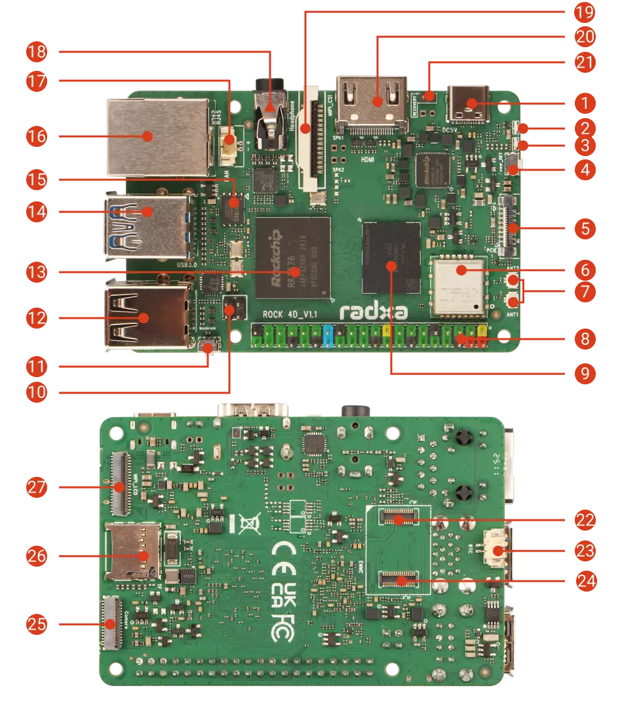
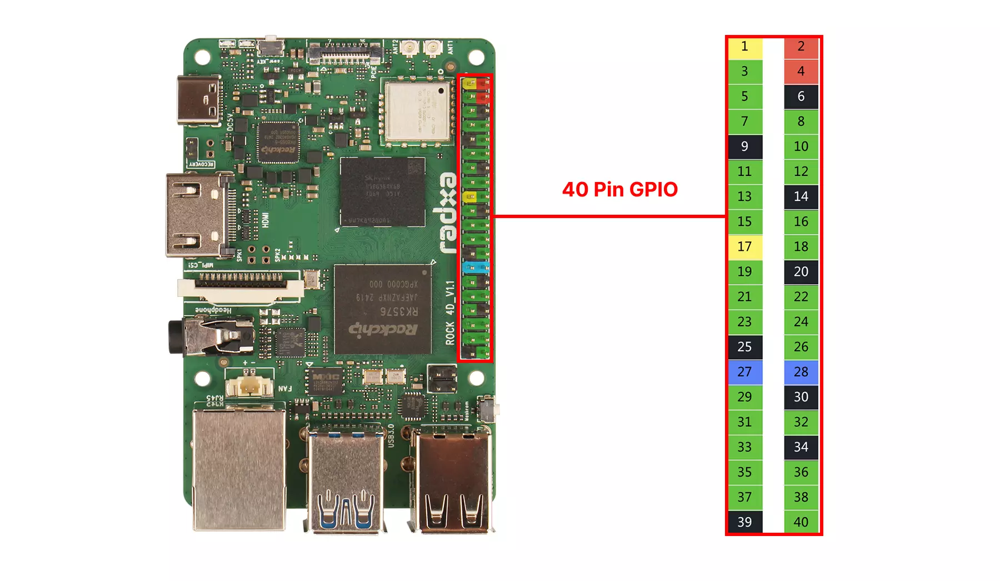

# Nerves System for the Radxa ROCK 4D (Rockchip RK3576)

This branch (`main`) uses the Rockchip vendor kernel and is the
recommended, fully-supported configuration. An experimental
[`mainline`](https://github.com/isaiahdw/nerves_system_rock_4d/tree/mainline)
branch builds a mainline LTS kernel instead; it needs no board patches
but currently lacks the NPU, GPU userspace, and analog audio.

This is a fork of
[isaiahdw/nerves_system_rock_4d](https://github.com/isaiahdw/nerves_system_rock_4d)
targeting boot from a UFS module instead of SD.

A [Nerves](https://nerves-project.org) system for the
[Radxa ROCK 4D](https://docs.radxa.com/en/rock4/rock4d) single-board
computer. Rockchip RK3576 (4x Cortex-A72 + 4x Cortex-A53, Mali-G52 MC3),
LPDDR5, Gigabit Ethernet, WiFi 6/BT 5.4, HDMI 2.1, USB 3.0, and a 40-pin
GPIO header. The IEx console is on `ttyFIQ0`, the 1.5 Mbaud debug UART on
header pins 8/10/6 (see `rootfs_overlay/etc/erlinit.config`).



In the diagram: 8 is the 40-pin header with the debug UART on pins 8
(TX), 10 (RX), 6 (GND); 11 is the MASKROM button, used together with the
upper USB 3.0 Type-A port (14) for `rkdeveloptool` (with an A-to-A cable); the eMMC/UFS
connector holds the UFS module with the Nerves firmware (the microSD slot,
26, is unused); 1 is the USB-C port, which is power only.

## Boot architecture

The RK3576 BootROM tries SPI NOR (FSPI0), then UFS, then USB maskrom; it
never boots SD. U-Boot lives in the onboard 16 MB SPI NOR and runs first
at power-on. Everything else is on the UFS module: the U-Boot
environment, kernels, and root filesystems.

The module has 4096-byte logical sectors, which stock tooling does not
expect. This system builds mainline U-Boot (v2027.01-rc1) in Buildroot
with UFS/SCSI support, and ships a flashing path that writes a 4096-byte
GPT (see "Flashing and upgrades"). Flash U-Boot to the NOR once over USB
maskrom (a host-side `rkdeveloptool` step, see
[uboot/README.md](uboot/README.md); each release attaches the SPI image,
the maskrom loader and their `SHA256SUMS`), **with the UFS module
removed**: the maskrom loader erases a seated module. After that, firmware updates are
normal Nerves A/B upgrades on the module and the bootloader doesn't need
to be touched again. About 14.4 MiB of the NOR stays free.

## Hardware support

Rows marked *(upstream)* come from the v0.1.x SD-boot release and were not
re-tested after the move to UFS. Everything else was measured on a ROCK 4D
with this fork's UFS boot chain on 2026-11-08.

| Feature | Status | Notes |
| --- | --- | --- |
| SD card | No | This fork boots from a UFS module; the SD slot is unused (the BootROM never boots SD) |
| A/B firmware slots | Yes | Upgrade to the inactive slot, revert of an unvalidated slot on reboot and on a power cycle, persistence once validated, `Nerves.Runtime.revert/0`; only env p1 changes and both GPTs stay intact |
| OTA updates (`mix upload`) | Yes | `fwup` over SSH; delta updates supported (fwup >= 1.12 on device) |
| Ethernet | Yes | Gigabit (1000/full measured), gmac0 + RTL8211F; DHCP |
| WiFi (onboard) | Yes | Quectel FCU760K (AIC8800D80, USB) via the out-of-tree [radxa-pkg/aic8800](https://github.com/radxa-pkg/aic8800) driver in `package/aic8800`. Re-enumerates from `a69c:8d80` to `8d81` after firmware upload and `aic8800_fdrv` loads; `wlan0` scans 2.4 and 5 GHz. Station mode verified: WPA2, DHCP, ~130 Mbit/s download |
| Bluetooth | Partial | `hci0` registers (aic_btusb, BlueZ mode); no BT userspace is included |
| HDMI display + console | Yes | Hotplug and EDID work; a 4K TV comes up at 3840x2160p60. The framebuffer console is on by default and a KMS app takes the display over |
| GPU (Mali G52 MC3) | Yes | Vendor kmod + libmali g29p1 (OpenGL ES 3.2, EGL 1.5, GBM; matched to the kbase DDK). The included `kmscube` smoke test renders on HDMI at the 60 Hz vsync. No UI toolkit in the system |
| USB input | Yes *(upstream)* | eudev + libinput (keyboards/mice/touchscreens) |
| Audio | Yes *(upstream)* | ES8388 headphone jack + HDMI audio via ALSA (aplay/amixer included) |
| Watchdog | Yes | dw-wdt armed by Erlang heart (`nerves_heart` 2.5.0, 44 s timeout), NOWAYOUT. Applications must complete the heart init handshake within 600 s (nerves_runtime's StartupGuard does), or heart reboots the board |
| RTC | Yes | HYM8563 (`rtc0`); keeps time and sets the clock at boot. Battery backup via the 2-pin socket on the board underside (CR2032 with a 1.25 mm-pitch plug lead, not a bare coin cell) |
| USB hosts | Yes | 2x USB3 + 2x USB2, all host-only: both dwc3 controllers are `dr_mode = "host"` in this device tree, so there is no `usb0` gadget ethernet |
| GPIO/I2C/SPI/PWM/UART/CAN header | Yes *(upstream)* | Via [Circuits.*](https://elixir-circuits.github.io/); see the 40-pin summary below |
| SPI NOR access | Yes | XMC XM25QU128C on the tested board. `loader` mtd + `flashcp` are included; copy the build's `images/u-boot-rockchip-spi.bin` over to reflash the bootloader from Linux (maskrom is the documented path) |
| PCIe / NVMe (FPC) | Untested | Enabled in the device tree; needs the M.2 HAT to verify |
| UFS modules | Yes | System disk: boot, A/B slots and ext4 data via mainline U-Boot in SPI NOR. Tested with a 128 GB YMTC YMUS8A1TE2D1C1 module (4096-byte sectors; LUN0 is `sda`, plus two 16 MiB LUNs). Power-on to SSH takes 20-30 s. Booting with no module fitted has not been tested |
| NPU (6 TOPS) | Yes | RKNPU driver 0.9.8 + librknnrt 2.3.2 runtime and headers (`package/librknnrt`). Inference verified with the rknn-toolkit2 v2.3.2 examples: MobileNetV1 ~3 ms, YOLOv5s-640 ~31 ms. Build models on the host with rknn-toolkit2 |
| MIPI DSI / CSI | No | Connectors unused; needs panel/camera bring-up |
| Onboard WiFi in AP mode | Yes *(upstream)* | VintageNetWiFi `mode: :ap` |
| Thermals | Yes | 2 minutes of all-core stress (2.016/2.208 GHz) peaked at 75.8 °C on the big cores without throttling, back to ~53 °C 10 s later |

## Building

Linux (or the Nerves Docker build environment) is required:

```sh
mix deps.get
mix compile
```

The result is a Nerves system artifact consumed by an application project.
U-Boot (`images/u-boot-rockchip-spi.bin`) is built as part of the system.

### Using in an application

Add the system to your app's `mix.exs` as a `:rock_4d` target (the package
is not on Hex; depend on this repository):

```elixir
@all_targets [:rock_4d]

# in deps():
{:nerves_system_rock_4d,
 github: "bbangert/nerves_system_rock_4d", tag: "v0.2.0",
 runtime: false, targets: :rock_4d}
```

Nerves downloads the prebuilt system artifact from this repo's GitHub
release for the tag. To build the system from source instead (requires
the Nerves Docker/Linux build environment, about an hour cold), add
`nerves: [compile: true]` to the dependency.

Then set `MIX_TARGET=rock_4d` for every mix command:

```sh
export MIX_TARGET=rock_4d
mix deps.get
mix firmware
```

## Flashing and upgrades

One-time setup: flash U-Boot to the SPI NOR
([uboot/README.md](uboot/README.md)).

To write the UFS module, put it in a USB UFS reader on the host and run:

```sh
sudo scripts/flash-ufs.sh <firmware>.fw /dev/sdX
```

The script builds the image (`fwup -d file.img`, then
`tools/mk_ufs_image.py` to rewrite the GPT for 4096-byte sectors and grow
`data` to fill the module), checks the target is a whole removable/USB
disk with nothing mounted or swapped on it (including through LVM, dm or
md), and writes it. It reads the module's exact size from the device,
which matters: the backup GPT goes at the true end of the disk.

**Never run `fwup -d /dev/sdX` or `mix burn` on the module.** fwup's GPT
writer is 512-byte only; the result is a partition table U-Boot and Linux
cannot read on a 4096-byte-sector LUN. `expand-data` is likewise not
available.

OTA upgrades use the standard Nerves flow (`mix upload`, or `fwup` over
SSH) and work unchanged on-device, since upgrade tasks only do
byte-addressed writes. Upgrades write only the inactive slot. The new
firmware boots unvalidated and U-Boot reverts to the previous slot unless
the application validates it (`Nerves.Runtime.validate_firmware/0`). A
fresh `complete` flash is marked validated.

## Boot flow

```
RK3576 boot ROM
  └─ SPI NOR: u-boot-rockchip-spi.bin  (TPL/DDR init + SPL @0, U-Boot FIT + BL31 @0x60000)
      └─ env: first 128 KiB of GPT p1 on the UFS LUN, found by p1's unique GUID
          └─ bootcmd = run nerves_init nerves_boot
              └─ Image.<slot> + rk3576-rock-4d.<slot>.dtb from p2 (FAT)
                  └─ squashfs rootfs on p3 (A) or p4 (B), root=PARTUUID=<slot GUID>
```

U-Boot locates the Nerves environment block by p1's GUID
(`CONFIG_ENV_IS_IN_SCSI`; `scripts/check-env-config.sh` fails the build if
fwup and U-Boot disagree on it), then boots the active slot directly from
the SCSI device whose p1 carries that GUID. The
env holds slot selection, the validation flag, and firmware metadata.
Unvalidated firmware reverts automatically: new firmware boots once, and
if the next boot still sees it unvalidated, U-Boot boots the other slot.
The env is a single copy, so a torn `saveenv` yields the default
environment and an extlinux boot without revert on that boot. If the
nerves boot path or the environment is broken, `bootflow scan` boots
`extlinux/extlinux.conf` from the FAT partition instead; that scan only
finds it because bootfs is the only partition marked bootable (GPT
legacy-BIOS-bootable attribute). `extlinux.conf` always names the last
validated slot: `complete` and validation write it, as does a manual
revert, and upgrades leave it alone. So a fallback boot never lands in an
unvalidated or rolled-back slot. U-Boot build
details and provenance: `uboot/README.md`.

Linux never mounts the bootfs: it is a 512-byte-BPB FAT (all fwup can
make) on a 4096-byte-sector LUN, so only U-Boot and fwup touch it and
there is no `/mnt/boot`.

### UFS module layout

GPT at LBA 1 (4096-byte LBAs; LBA 0 is the protective MBR, entries occupy
LBA 2-5); the backup GPT sits at the end of the module.

| Partition         | Start LBA | Byte offset | Size       | Contents                         |
| ----------------- | --------- | ----------- | ---------- | -------------------------------- |
| p1 `env`          | 256       | 1 MiB       | 1 MiB      | Nerves U-Boot env, first 128 KiB |
| p2 `bootfs` (FAT) | 4096      | 16 MiB      | 256 MiB    | Image.a/b, dtb, extlinux         |
| p3 `rootfs-a`     | 69632     | 272 MiB     | 512 MiB    | squashfs                         |
| p4 `rootfs-b`     | 200704    | 784 MiB     | 512 MiB    | squashfs                         |
| p5 `data` (ext4)  | 331776    | 1296 MiB    | to the end | Application data (`/data`); sized by the image tool |

## Kernel

The kernel source is [armbian/linux-rockchip](https://github.com/armbian/linux-rockchip)
branch `rk-6.1-rkr7.2` (6.1.172; Rockchip BSP 6.1 + upstream-stable merges + Armbian
fixes), pinned by commit SHA in `nerves_defconfig` and fetched by Buildroot
as a GitHub archive. Radxa's ROCK 4D device tree (`rk3576-rock-4d-spi`)
is already in this tree. There are two board patches. `linux/0001`
does two things: it enables the watchdog node (shipped disabled;
`nerves_heart` requires `/dev/watchdog0`) and re-points the `mmc0` alias
at the SD card. Only the watchdog half matters for UFS boot; the alias
half dates from SD boot (it made the SD card `/dev/mmcblk0`) and is
harmless here, as nothing uses the SD card. `linux/0002` sets the HDMI
DDC SDA falling delay (`rockchip,sda-falling-delay-ns = <360>`, as on
Rockchip's RK3576 EVB). Without it, EDID reads corrupt and only fallback
modes up to 1080p are offered.

The configuration is the in-tree `rockchip_linux_defconfig` plus two
fragments: `linux/rk3576.config` (Mali Bifrost; rkr7.2 no longer enables it in the defconfig) and `linux/nerves.config`
(Nerves requirements and board deltas, documented inline). One board
delta worth knowing about: `CONFIG_REALTEK_PHY` for the RTL8211F, which
the vendor defconfig lacks.

Mainline support for the ROCK 4D is improving: the dts landed in 6.15,
ethernet/PCIe/USB/HDMI-audio/UFS were complete around 6.17, and mainline
U-Boot supports the board since v2026.01 (this system uses v2027.01-rc1). A
future migration to a mainline kernel plus Panfrost would drop most of
the vendor code this system carries.

## Hardware reference

| Peripheral | Device | Notes |
| --- | --- | --- |
| SoC | Rockchip RK3576 (RK3576J on industrial SKUs), 4×Cortex-A72 @ 2.2 GHz + 4×Cortex-A53 @ 2.0 GHz | RK806 PMIC (i2c 0x23) |
| RAM | LPDDR5, 2/4/6/8/16 GB SKUs | DDR init blob v1.13 handles LP4/LP5 and the 6 GB (3/4-row) parts |
| Boot flash | 16 MB SPI NOR on sfc0 (XMC XM25QU128C on the tested board) | mtd `loader`; holds U-Boot |
| microSD | sdmmc, UHS-I SDR104 | Unused by this fork |
| eMMC/UFS connector | UFS modules 64 GB–1 TB | The Nerves system disk (4096-byte sectors); eMMC modules unsupported on SPI-NOR (standard) SKUs |
| Ethernet | GbE, gmac0 + Realtek RTL8211F (RGMII) | PoE via the optional PoE+ HAT |
| WiFi/BT | Quectel FCU760K (AIC8800D80, USB a69c:8d80→8d81), WiFi 6 + BT 5.4, external antennas | package/aic8800 driver; wlan0 + hci0 |
| Display | HDMI 2.1 up to 4K@120 (VOP + Samsung HDPTX PHY) | fbcon on by default; app takes over DRM |
| MIPI | DSI 4-lane (up to 2K); CSI 1× 4-lane (or 2× 2-lane) + 1× 2-lane | Not brought up |
| GPU | Mali G52 MC3 | Vendor kmod (`/dev/mali0`) + libmali GBM blob (g29p1, matched to the kbase DDK) |
| NPU | 6 TOPS INT8 RKNPU | Kernel driver 0.9.8 + librknnrt 2.3.2 |
| Audio | ES8388 codec (3.5 mm 4-pole headphone + mic, drives 32 Ω) + HDMI audio | ALSA; es8323 driver via fallback compatible |
| USB | 2× USB3 host (upper is also the maskrom port), 2× USB2 hosts | No gadget/`usb0`: the device tree sets both dwc3 controllers to host mode |
| PCIe | Gen2 x1 over 16-pin FPC (RPi 5-style) | M.2 NVMe via Radxa HAT; dts-enabled, untested |
| RTC | Haoyu HYM8563 (i2c 0x51), 2-pin XH battery connector (CR2032) | Sets system clock at boot |
| Fan | 2-pin XH 1.25 mm, 5 V PWM | pwm-fan in dts, thermal-zone driven |
| Debug UART | UART0, header pins 8 (TX) / 10 (RX) / 6 (GND) | 1500000 8N1; `ttyFIQ0` console |
| LEDs | power (default-on), user (heartbeat) | gpio-leds, `/sys/class/leds` |
| Power | 5 V only: USB-C (PD adapters OK, board takes 5 V fixed), header pins 2/4, or PoE+ HAT | ≥3 A recommended |

### 40-pin header



3.3 V logic. Functions muxed onto the header: 4× I2C (I2C5/6/8/9),
6× UART (UART0 debug + UART2/3/4/7/10, several with RTS/CTS), 2× SPI
(SPI1/SPI2), PWM channels from all three controllers, 3× SAI (I2S) +
PDM mic inputs, CAN1, and I3C0. Power: 3V3 on pins 1/17, 5V on 2/4,
grounds on 6/9/14/20/25/30/34/39. Use them from Elixir with
[Circuits.GPIO/I2C/SPI/UART](https://elixir-circuits.github.io/).

---

*Board images: [Radxa Documentation](https://docs.radxa.com/en/rock4/rock4d),
© Radxa Computer (Shenzhen) Co., Ltd., licensed under
[CC BY 4.0](https://creativecommons.org/licenses/by/4.0/).*
