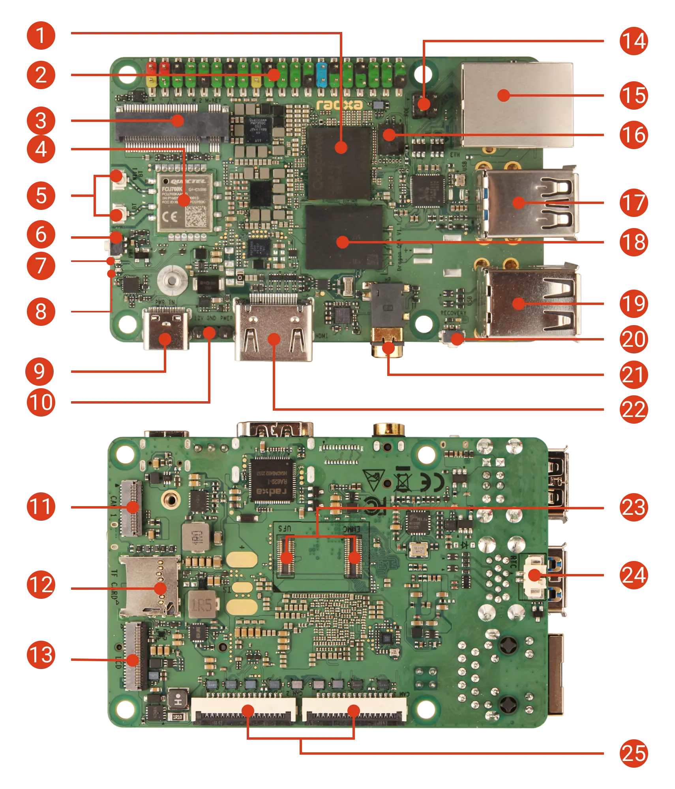
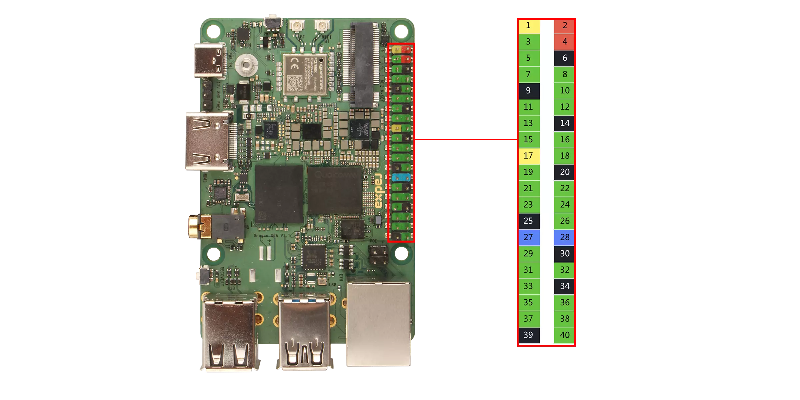

# Nerves System for the Radxa Dragon Q6A (Qualcomm QCS6490)

A [Nerves](https://nerves-project.org) system for the
[Radxa Dragon Q6A](https://docs.radxa.com/en/dragon/q6a) single-board
computer. Qualcomm QCS6490 (1+3+4 Kryo clusters: Cortex-A78 big cores and
4x Cortex-A55, Adreno 643 GPU, Hexagon DSP + tensor accelerator rated at
12 TOPS combined), 4–16 GB LPDDR5, an M.2 M-key 2230 NVMe slot and an
eMMC/UFS combo module connector (the Nerves firmware lives on NVMe or a
UFS module), Gigabit Ethernet, WiFi 6 / BT 5.4 (Quectel FCU760K,
AIC8800D80 over USB), HDMI, 1x USB 3.1 + 3x USB 2.0, and a 40-pin GPIO
header. The IEx console is on `ttyMSM0`, the GENI debug UART at 115200n8
(UART5: header pins 8 TX / 10 RX / 6 GND, per the devicetree's
`serial0 = &uart5` and Radxa's pin table).



In the diagram: 2 is the 40-pin header with the debug UART; 20 is the EDL
button, used with the lower USB 3.1 OTG Type-A port (17) and a USB A-to-A
cable for `edl-ng`; 3 (M.2 NVMe) and 23 (eMMC/UFS combo connector) each
can hold the Nerves firmware; 16 is the 32 MB QSPI NOR that holds EDK2
UEFI; 9 is USB-C 12 V power (10 is the 12 V power header, 14 the PoE HAT
header).

## Boot architecture

The board's first-stage boot (PBL → XBL → TZ) and EDK2 UEFI live in the
onboard SPI NOR. That firmware is a one-time, user-flashed prerequisite:
flash Radxa's **flat_build** SPI firmware package per
[Radxa's SPI firmware docs](https://docs.radxa.com/en/dragon/q6a/low-level-dev/spi-fw).
EDK2 scans GPT disks and runs `\EFI\BOOT\BOOTAA64.EFI` (GRUB2, arm64-efi)
from the ESP on the NVMe or UFS disk. GRUB reads `grubenv` for the active
slot and boots the kernel `Image` and devicetree **from inside the active
squashfs slot**, so kernel, DTB, firmware blobs and rootfs update
atomically per A/B slot.

The mainline DTB is loaded explicitly by GRUB. EDK2's own devicetree is
Radxa's 6.18-era tree whose CDSP carve-out (`cdsp_mem@8e000000`) does not
match the mainline board DTS (`cdsp_mem@87000000`); with it the CDSP boots
but every fastrpc invoke fails (device-proven 2026-07-24). If the DTB load
fails, `grub.cfg` falls back to the firmware DT: the system boots, DSP
offload does not. Memory reservations arrive via the EFI memory map either
way.

A fresh board boots Nerves after one EDL flash of the disk image (EDL is
the Qualcomm Emergency Download mode the boot ROM enters when the EDL
button is held at power-on; it is how a host writes the NVMe or UFS disk
directly). After that, firmware updates are normal Nerves A/B upgrades.

Two differences from U-Boot-based Nerves systems:

- **Unvalidated firmware is not auto-reverted.** `grub.cfg` has no
  fallback logic, and the upgrade tasks mark the new slot validated when
  they switch to it. Revert is explicit (`Nerves.Runtime.revert/1`, or
  `fwup -t revert` with `/usr/share/fwup/ops.fw`).
- **An OTA cannot change `grub.cfg`.** fwup writes it to the ESP only in
  `task complete`; `upgrade.a`/`upgrade.b` carry the rootfs slot and
  `grubenv` alone. A kernel cmdline change needs a full reflash.

## Hardware support

All proofs were taken on the nerves_system_br 1.34.4 / toolchain 15.3.0
line, while this system was the `dragon_q6a` target of nerves_system_vagus
(the 1.35.3 / 15.3.1 move is build-proof only until re-gated); the evidence
for every row is in [docs/validation.md](docs/validation.md).

| Feature | Status | Notes |
| --- | --- | --- |
| NVMe or UFS boot, A/B firmware slots | Yes | NVMe and UFS-module boards booted 2026-10-12; A/B revert on UFS; UFS 4Kn image via `tools/mk_ufs_image.py` |
| OTA updates (`mix upload` / fwup) | Yes | OTA from 0.3.3 proven 2026-10-12; `grub.cfg` itself is not OTA-updatable |
| Ethernet (Realtek, r8169) | Yes | Part of the base gate sequence |
| WiFi (onboard AIC8800D80, USB) | Yes | Out-of-tree [radxa-pkg/aic8800](https://github.com/radxa-pkg/aic8800) in `package/aic8800`; scan 2.4/5 GHz 2026-10-12; WPA2 and WPA3-SAE association proven 2026-07-25/26. See [docs/wifi-bt.md](docs/wifi-bt.md) |
| Bluetooth | Partial | `hci0` via `aic_btusb` (BlueZ mode); BLE scan/advertise/GATT proven with BlueZ 5.79 supplied by a product layer; no BT userspace in this system; see [docs/wifi-bt.md](docs/wifi-bt.md) for the mandatory advertising-interval setting |
| HDMI display | No | mdss left disabled in the DTS |
| GPU (Adreno 643) | Partial | `/dev/dri/renderD128` appears and the a660 firmware loads; no Mesa shipped |
| USB hosts | Partial | Both dwc3 controllers up, 5 Gbps root hub registers; no 5 Gbps device enumerated yet |
| USB gadget (`usb0`) | No | Kernel gadget support is built, but no gadget function is configured |
| Audio (WCD938x headphone jack) | Partial | Playback via `aplay` proven with the mixer recipe in [docs/audio.md](docs/audio.md); capture unvalidated |
| Watchdog (qcom_wdt + nerves_heart) | Yes | Base gate sequence |
| RTC | Untested | 2-pin battery connector; the DTS has an `st,m41t11` at i2c10 0x68 (`rtc-ds1307`, module); no proof recorded |
| 40-pin GPIO/I2C/SPI/UART header | Untested | Debug UART only; no Circuits.* proof recorded |
| PCIe / M.2 NVMe | Yes | One of the two proven boot disks |
| UFS module | Yes | Proven 2026-08-02 and 2026-10-12 (kernel patches 0002/0003 required) |
| NPU / DSP (Hexagon v68 via fastrpc) | Yes | `fastrpc_test -a v68` 3/3 and QNN inference on the DSP from a container, 2026-10-12; the QAIRT 2.48 yolov11 host recipe was last validated on kernel 7.1.4. See [docs/ai-foundation.md](docs/ai-foundation.md); the app starts the fastrpc daemons ([docs/dsp-supervision.md](docs/dsp-supervision.md)) |
| Video codec (Venus) | Partial | Decoder 30/30 frames 2026-10-12 (`test_src/venus_dec_smoke`); encoder untested |
| MIPI CSI / DSI | No | Not brought up |
| microSD | Untested | Enabled in the DTS; not used by this system |
| PoE+ HAT fan | Yes | `gpio-fan` on GPIO_56 bound to the `cpuss0` thermal zone (patch 0004); part of the 2026-10-12 gate |
| Hardware-debug device classes (hidraw, usbmon, USB/IP, CAN, knfsd…) | Untested | `linux-hwdebug.config`; build-proof only |

## Building

Linux (or the Nerves Docker build environment) is required:

```sh
mix deps.get
mix compile
```

The result is a Nerves system artifact consumed by an application project.

### Using in an application

Add the system to your app's `mix.exs` as a `:q6a` target (the package is
not on Hex; depend on this repository):

```elixir
@all_targets [:q6a]

# in deps():
{:nerves_system_q6a,
 github: "bbangert/nerves_system_q6a", tag: "v0.1.0",
 runtime: false, targets: :q6a}
```

Nerves downloads the prebuilt system artifact from this repo's GitHub
release for the tag. To build the system from source instead (requires the
Nerves Docker/Linux build environment), add `nerves: [compile: true]` to
the dependency.

Then set `MIX_TARGET=q6a` for every mix command:

```sh
export MIX_TARGET=q6a
mix deps.get
mix firmware
```

## Flashing and upgrades

One-time setup: flash EDK2 to the SPI NOR from Radxa's flat_build package
(see [Boot architecture](#boot-architecture)).

The disk is written over EDL; the full runbook (host udev rule, qcserial
blacklist, EDL entry sequence, recovery paths, UFS provisioning) is
[docs/flashing.md](docs/flashing.md). In short, for NVMe:

```sh
mix firmware
fwup -a -t complete -i _build/q6a_dev/nerves/images/<app>.fw -d q6a.img
./edl-ng --loader prog_firehose_ddr.elf --memory nvme write-sector 0 q6a.img
```

For a UFS module the same `.fw` is used; `tools/mk_ufs_image.py` turns
`q6a.img` into a two-piece image with a GPT for 4096-byte sectors, and
both pieces are written with `--memory ufs`.

EDL writes the image verbatim, so on NVMe `/data` starts at 512 MiB. Grow
it once with the `expand-data` op (**NVMe only, never on UFS**: fwup's GPT
code is 512-byte-sector only and would corrupt the 4Kn GPT;
`mk_ufs_image.py` already sized `/data` to the module):

```sh
fwup -t expand-data -d /dev/rootdisk0 /usr/share/fwup/ops.fw
reboot
resize2fs /dev/rootdisk0p5
```

OTA upgrades use the standard Nerves flow (`mix upload`, or `fwup` over
SSH) and write only the inactive slot. The new slot is marked validated as
it is switched to, so there is no automatic revert on a failed boot;
revert explicitly with `Nerves.Runtime.revert/1`.

## Boot flow

```
PBL / XBL (SPI NOR)
  └─ EDK2 UEFI: \EFI\BOOT\BOOTAA64.EFI from p2 (ESP)
      └─ GRUB2 arm64-efi: load_env grubenv -> active slot
          ├─ devicetree (hdN,gpt3|4)/boot/qcs6490-radxa-dragon-q6a.dtb  (falls back to the firmware DT)
          └─ linux (hdN,gpt3|4)/boot/Image root=PARTUUID=<slot GUID>
              └─ squashfs rootfs on p3 (A) or p4 (B)
```

`hdN` is derived from GRUB's `$root`, because the disk number depends on
which controllers are populated (an NVMe-only board is `hd0`, a UFS board
`hd2`). The rootfs PARTUUIDs in `grub.cfg` match the GPT GUIDs in
`fwup_include/fwup-common.conf`.

### Disk layout

From `fwup_include/fwup-common.conf` (512-byte sectors; the UFS image keeps
the same byte offsets with a 4096-byte-sector GPT):

| Region | Offset (512 B sectors) | Size | Contents |
| --- | --- | --- | --- |
| GPT | 0 | | |
| Nerves env (uboot-env format) | 2048 (1 MiB) | 8 KiB | Firmware metadata (`fw_env.config`) |
| p1 `config` (FAT) | 32768 (16 MiB) | 16 MiB | Empty; mirrors RadxaOS's first partition, usable as a provisioning store |
| p2 `efi` (FAT, ESP) | 65536 | 64 MiB | `EFI/BOOT/BOOTAA64.EFI`, `grub.cfg`, `grubenv` |
| p3 `rootfs-a` | 196608 | 512 MiB | squashfs, `/boot/Image` + DTB inside |
| p4 `rootfs-b` | 1245184 | 512 MiB | squashfs |
| p5 `data` (ext4) | 2293760 | 512 MiB, expands | Application data (`/data`, reported as `/root`) |

## Kernel

Mainline Linux **7.2.10** (`BR2_LINUX_KERNEL_CUSTOM_VERSION_VALUE`) with the
in-tree `qcom/qcs6490-radxa-dragon-q6a` devicetree. The configuration is
`linux-7.2.defconfig` plus the `linux-hwdebug.config` fragment
(hardware-debug device classes). Notable settings: `QCOM_FASTRPC` built in,
`CFG80211_REQUIRE_SIGNED_REGDB` (so `wireless-regdb` is mandatory),
policy routing for `vintage_net`, `VIDEO_QCOM_IRIS` off so Venus keeps the
codec, and a 60 s deferred-probe timeout so the GPU SMMU outlasts the
gpucc module load.

Board patches in `patches/linux/`, none of which is in mainline v7.2.10:

- `0001`: USB3. Enables the SuperSpeed controller and the USB-A SS lanes
  (a USB-only trim of Armbian's USB3/HDMI patch).
- `0002`: UFS. Enables the UFS controller and PHY (HS-Gear-4 Rate-A, ICE
  off; from Armbian's qcs6490 series).
- `0003`: the qmp-ufs sc7280 HS-G4 PHY init table from Radxa's kernel tree;
  without it UFS does not link up.
- `0004`: PoE+ HAT fan. A two-state `gpio-fan` on GPIO_56 (header pin 33,
  active low) on the `cpuss0` thermal zone, on at 60 °C, off at 50 °C;
  `spi14` is disabled because its pin group claims that GPIO.

`br-patches/busybox/0001` makes busybox `modprobe` keep dots in modalias
names; without it `qcom,adreno-635.0` never matches and msm never
autoloads. `/etc/modprobe.d/msm.conf` sets `separate_gpu_kms=1` because the
DTS leaves mdss disabled.

A move to 7.2.15 is pending. Kernel bumps follow
[docs/kernel-maintenance.md](docs/kernel-maintenance.md).

## Hardware reference

| Peripheral | Device | Notes |
| --- | --- | --- |
| SoC | Qualcomm QCS6490: 1x Kryo Gold Plus @ 2.7 GHz + 3x Kryo Gold @ 2.4 GHz + 4x Kryo Silver @ 1.9 GHz | Cortex-A78 / Cortex-A55 cores; built with `-march=armv8.2-a` |
| RAM | LPDDR5, 4/6/8/12/16 GB SKUs | |
| Boot flash | 32 MB QSPI NOR | EDK2 UEFI (Radxa flat_build), user-flashed |
| Storage | M.2 M-key 2230 NVMe; eMMC/UFS combo connector; microSD | NVMe and UFS proven as the Nerves disk; eMMC and microSD unused |
| Ethernet | 1x Gigabit RJ45, Realtek PCIe NIC (r8169) | `eth0`; PoE via the optional PoE HAT |
| WiFi/BT | Quectel FCU760K (AIC8800D80, USB `a69c:8d80` → `8d81`), WiFi 6 + BT 5.4, external antennas | `package/aic8800`; `wlan0` + `hci0` |
| Display | HDMI (up to 4K@30), 4-lane MIPI DSI | Off: mdss disabled in the DTS |
| Cameras | 1x 4-lane + 2x 2-lane MIPI CSI | Unused |
| GPU | Adreno 643 | `drm/msm`, render node only; no Mesa |
| NPU / DSP | Hexagon DSP + Hexagon Tensor Accelerator (v68 CDSP), 12 TOPS combined | fastrpc; QAIRT user-provisioned to `/data` |
| Video | Venus: decode up to 4K@60, encode up to 4K@30 (H.264/H.265) | V4L2 M2M, `/dev/video0` and `/dev/video1` |
| Audio | 3.5 mm 4-pole headphone jack with mic (WCD938x codec), drives 32 Ω | ALSA; see [docs/audio.md](docs/audio.md) |
| USB | 1x USB 3.1 Type-A OTG (lower port of 17, the EDL port), 3x USB 2.0 Type-A | Onboard hub and the WiFi/BT module on the USB2 tree |
| PCIe | M.2 M-key slot | NVMe |
| RTC | `st,m41t11`-compatible at i2c10 0x68; 2-pin 1.25 mm CR2032 connector | `rtc-ds1307` module; untested |
| Fan | Via the Radxa PoE+ HAT, header pin 33 (GPIO_56) | Thermal-zone driven (patch 0004) |
| Debug UART | UART5 on header pins 8 (TX) / 10 (RX) / 6 (GND) | 115200n8, `ttyMSM0` console |
| LEDs | Power LED, blue user LED (`gpio-leds` on GPIO 42) | `/sys/class/leds` |
| Power | USB-C 12 V (PD), 3-pin 12 V header, or PoE via the PoE HAT | |
| Buttons | Power, EDL | EDL is held at power-on to enter Qualcomm EDL mode |

### 40-pin header



Power: 3V3 on pins 1/17, 5V on 2/4, grounds on 6/9/14/20/25/30/34/39.
Functions muxed onto the header: I2C0/2/6/7/12/14, SPI0/2/5/6/7/12/13/14,
UART0/2/5/6/7/12/13/14, I3C0, and MI2S0 (I2S). UART5 on pins 8/10 is the
console, and pin 33 (GPIO_56) belongs to the PoE+ HAT fan, which is why
`spi14` is disabled. Which function a pin carries is fixed by the
devicetree (it enables i2c0/2/6 and spi7/12 among others), not at runtime.
Use the header from Elixir with
[Circuits.GPIO/I2C/SPI/UART](https://elixir-circuits.github.io/).

---

*Board images: [Radxa Documentation](https://docs.radxa.com/en/dragon/q6a), © Radxa Computer (Shenzhen) Co., Ltd., licensed under [CC BY 4.0](https://creativecommons.org/licenses/by/4.0/).*
