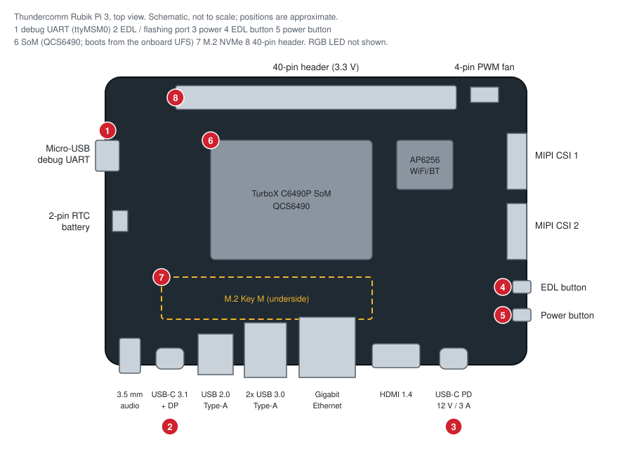
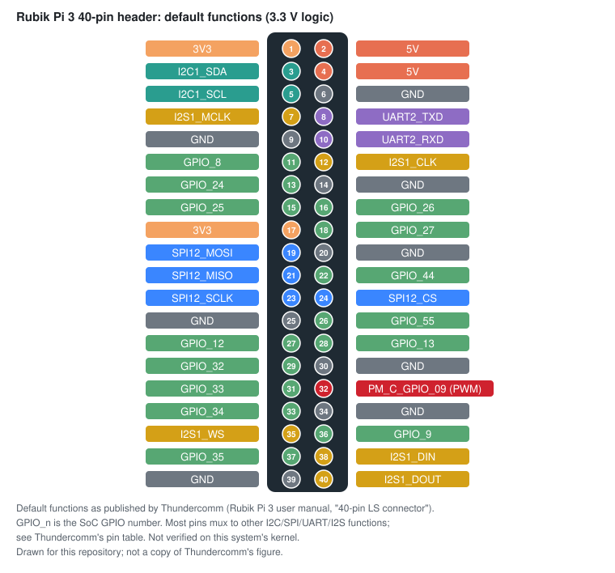

# Nerves System for the Thundercomm Rubik Pi 3 (Qualcomm QCS6490)

A [Nerves](https://nerves-project.org) system for the
[Thundercomm Rubik Pi 3](https://www.thundercomm.com/rubik-pi-3/en/docs/about-rubikpi)
single-board computer. Qualcomm QCS6490 (Kryo 670: Cortex-A78 + Cortex-A55,
Adreno 643L GPU, Hexagon DSP/NPU rated at 12 TOPS), 8 GB LPDDR4x, 128 GB
onboard UFS 2.2, gigabit Ethernet (a USB AX88179B behind a uPD720201 USB3
controller), WiFi 5 / BT 5.2 (AMPAK AP6256), HDMI 1.4 plus DisplayPort over
USB-C, 2x USB 3.0 Type-A + 1x USB 2.0 Type-A + USB-C, an M.2 Key M slot
(PCIe 3.0 x2), 2x 4-lane MIPI CSI, a 40-pin header and a 4-pin PWM fan
connector. The IEx console is on `ttyMSM0` (115200n8), reached over the
board's micro-USB debug port through an onboard WCH CH343 bridge
(`1a86:55d3`; the host sees `/dev/ttyACM0`).



In the diagram: 1 is the micro-USB debug port with the IEx console; 2 is
the USB-C 3.1 port used for EDL flashing (the host sees `05c6:9008`); 3 is
the USB-C power input, which needs a 12 V / 3 A PD supply; 4 and 5 are the
EDL and power buttons; 6 is the SoM, and the system boots from the
onboard UFS (there is no removable boot media); 7 is the M.2 slot on the
underside.

## Boot architecture

The board has no SPI NOR. PBL → XBL → Thundercomm's UEFI build (XBL,
UEFI, TrustZone, the hypervisor and the firmware DT all live on UFS LUNs
1-6) → the removable-media path on the LUN0 ESP (`\EFI\BOOT\BOOTAA64.EFI`,
which is GRUB2 arm64-efi here; stock ships systemd-boot there). The
firmware shows no boot menu and runs Linux under the Gunyah hypervisor.

UFS LUN0 is the only LUN Nerves writes. LUNs 1-6 hold the boot firmware
and are never touched, so a new board boots this system as soon as LUN0
holds it. Getting it there is what EDL (Qualcomm's Emergency Download
mode, USB `05c6:9008`) is for: a fresh board is flashed once over USB-C
with `qdl`, and after that firmware updates are normal Nerves A/B
upgrades. **Back up the `persist` partition before the first flash**
(see [Flashing and upgrades](#flashing-and-upgrades)); the Nerves layout
overwrites it.

GRUB reads `grubenv` for the active slot and boots the kernel `Image`
from inside the active squashfs slot (`squash4` module), so kernel,
devicetree, firmware blobs and rootfs update atomically per slot.

GRUB loads the in-tree `qcs6490-thundercomm-rubikpi3.dtb` from the active
slot (`devicetree`) instead of relying on the firmware DT. On the Dragon
Q6A (same SoC, different firmware) the firmware DT's CDSP reserved-memory
layout did not match the mainline DTS, so the CDSP booted but every
fastrpc invoke failed. Whether Thundercomm's firmware DT has the same
mismatch was not checked; the explicit load is proven to boot. If the DTB
load fails, `grub.cfg` falls back to the firmware DT (the system boots;
DSP offload is degraded).

Unvalidated firmware is **not** automatically reverted. `grub.cfg` has
no fallback logic, so the `upgrade` tasks in `fwup.conf` mark the new
slot validated as they write it. A slot that does not boot needs a
reflash over EDL.

## Hardware support

All proofs were taken on the nerves_system_br 1.34.4 / toolchain 15.3.0
line (the 1.35.3 / 15.3.1 move is build-proof only until re-gated); the
evidence for every row, with dates, is in [docs/validation.md](docs/validation.md).

| Feature | Status | Notes |
| --- | --- | --- |
| UFS boot (4Kn GPT), A/B slots | Yes | 2026-10-23; `/data` formats to full size on first boot |
| OTA updates (`mix upload`) | Yes | A → B → A over SSH, both slots report `firmware_valid?` |
| Serial console | Yes | iex on `ttyMSM0` over the micro-USB debug port |
| Ethernet (USB AX88179B) | Yes | DHCP and internet, proven on the layered vagus image; the standalone image relies on `rubik-usb-fw` (uPD720201 firmware from the board's `usb_fw` partition), re-gate on the standalone image pending |
| WiFi (AP6256, brcmfmac SDIO) | Partial | Scan on both bands, WPA2-PSK proven with firmware 7.45.96.215; WPA3-SAE not supported (firmware/brcmfmac mismatch, see [docs/wifi-bt.md](docs/wifi-bt.md)); AP mode untested |
| Bluetooth (BCM4345C5, hci_bcm serdev) | Partial | Controller powers on and discovers under BlueZ started by hand; no BT userspace in this system |
| HDMI display (LT9611) | Partial | msm DRM binds DSI/DP/Adreno, bridge detected; no monitor attached, scan-out untested |
| DisplayPort over USB-C | Untested | |
| GPU (Adreno 643L) | Partial | `renderD128` present, a660 SQE/GMU firmware loads; no userspace (Mesa not shipped) |
| USB 3.0 Type-A | Yes | SuperSpeed via the uPD720201, proven on the layered vagus image; the standalone image relies on `rubik-usb-fw`, re-gate on the standalone image pending |
| USB 2.0 Type-A | Untested | |
| USB-C gadget (`usb0`) | No | The UDC probes; no gadget function is configured |
| Audio (3.5 mm jack) | Untested | No proof recorded |
| Watchdog (gunyah_wdt) | Yes | `/dev/watchdog0`, armed by `nerves_heart` (32 s) |
| RTC (PMIC) | Partial | Holds time across reboot; no backup battery was fitted (2-pin connector), so 1970 after power loss and TLS fails until NervesTime syncs (~3 min): wait for `NervesTime.synchronized?/0`. `CONFIG_RTC_HCTOSYS` is off, see [docs/validation.md](docs/validation.md) |
| Board id / hostname from SoC serial | Untested | `rubik-boardid`, build-proof only |
| 40-pin header (GPIO/I2C/SPI/UART) | Untested | |
| PCIe / M.2 NVMe (data) | Yes | Samsung 970 EVO Plus, ~1 GiB/s; needs patch 0004 (`aspm-no-l1ss`); not a boot option |
| NPU / DSP (fastrpc + QAIRT) | Yes | `fastrpc_test` 3/3 on the CDSP; QAIRT 2.47 HTP context-binary run, 2026-10-23. See [docs/ai-foundation.md](docs/ai-foundation.md); the app starts the fastrpc daemons ([docs/dsp-supervision.md](docs/dsp-supervision.md)) |
| Video codec (Venus) | Partial | Decode 30/30 frames; encode untested; device nodes in [docs/ai-foundation.md](docs/ai-foundation.md) |
| MIPI CSI cameras | No | No sensor bring-up |
| PWM fan | Partial | `pwm-fan` cooling device bound to `cpu0-thermal`; no fan fitted, spin-up untested |
| RGB LED | Untested | |
| Hardware-debug device classes | Untested | `linux-hwdebug.config`, build-proof only |

## Building

Linux is required:

```sh
mix deps.get
mix compile
```

The result is a Nerves system artifact consumed by an application project.

### Using in an application

Add the system to your app's `mix.exs` as a `:rubik_pi3` target (the
package is not on Hex; depend on this repository):

```elixir
@all_targets [:rubik_pi3]

# in deps():
{:nerves_system_rubik_pi3,
 github: "bbangert/nerves_system_rubik_pi3", tag: "v0.1.1",
 runtime: false, targets: :rubik_pi3}
```

Nerves downloads the prebuilt system artifact from this repo's GitHub
release for the tag. To build the system from source instead, add
`nerves: [compile: true]` to the dependency.

Then set `MIX_TARGET=rubik_pi3` for every mix command:

```sh
export MIX_TARGET=rubik_pi3
mix deps.get
mix firmware
```

## Flashing and upgrades

There is no removable boot media, so there is no `mix burn`. The first
install goes over EDL with [qdl](https://github.com/linux-msm/qdl) (2.x;
built from source with `-Dnbdkit=disabled`) and `prog_firehose_ddr.elf`
from Thundercomm's FlatBuild package. To enter EDL: unplug both USB-C
cables, hold the EDL button, connect the 12 V PD supply, connect the
USB-C 3.1 port to the host, wait three seconds and release. The host sees
`05c6:9008`. Write **LUN0 only**.

**Back up `persist` before the first flash.** Stock LUN0 is `efi`
(512 MiB), `persist` (30 MiB, ext4: factory QTEE/QWES attestation and
license stores) and `system`. The Nerves layout overwrites `persist` (it
sits inside `rootfs-a`) and the FlatBuild never rewrites it (empty
`filename` in `rawprogram0.xml`), so once LUN0 has been written there is
no way to get it back. Take it while the stock layout is still there:

```sh
qdl --storage ufs prog_firehose_ddr.elf read 0/persist lun0_persist.bin
ls -l lun0_persist.bin   # 31457280 bytes (30 MiB)
```

qdl resets the board when it finishes, so re-enter EDL before flashing.
The UFS uses 4096-byte logical blocks and fwup writes 512-byte GPTs, so
`tools/mk_ufs_image.py` regenerates the GPT for the physical write:

```sh
mix firmware
fwup -a -t complete -i _build/rubik_pi3_dev/nerves/images/<app>.fw -d rubik.img
# Exact LUN0 capacity: 29976576 sectors x 4096 on the 128 GB module (the
# kernel's sd 0:0:0:0 line or the stock GPT's BackupLBA + 1 gives it).
python3 tools/mk_ufs_image.py --input rubik.img \
    --disk-bytes $((29976576 * 4096)) --out rubik_ufs
qdl --storage ufs prog_firehose_ddr.elf \
    write 0/0 rubik_ufs.img \
    write 0/29976571 rubik_ufs-backup-gpt.bin   # LBA the tool prints
```

qdl resets the board when it finishes; it boots straight into Nerves.

To go back to stock: flash the FlatBuild's `rawprogram0.xml` +
`patch0.xml` (LUN0), then
`qdl --storage ufs prog_firehose_ddr.elf write 0/persist lun0_persist.bin`.

After that, upgrades use the standard Nerves flow: `mix upload`, or
`fwup` over SSH. An upgrade writes only the inactive slot and switches
`grubenv` to it. As described under
[Boot architecture](#boot-architecture), the new slot is validated as it
is written; there is no automatic revert.

Do **not** run fwup's `expand-data` task on this board: fwup's
`gpt_write()` is hardwired to 512-byte LBAs and would corrupt the 4Kn GPT.
`mk_ufs_image.py` already sizes `/data` to fill LUN0.

## Boot flow

```
PBL (boot ROM)
  └─ XBL → Thundercomm UEFI            (UFS LUNs 1-6, never written by Nerves)
      └─ \EFI\BOOT\BOOTAA64.EFI = GRUB2 arm64-efi   (UFS LUN0, p2 ESP)
          └─ grub.cfg + grubenv: pick slot A or B
              └─ devicetree /boot/qcs6490-thundercomm-rubikpi3.dtb   (from the slot)
                  └─ linux /boot/Image under the Gunyah hypervisor
                      └─ squashfs rootfs on p3 (A) or p4 (B), root=PARTUUID=<slot GUID>
```

GRUB's disk number for LUN0 varies (the other LUNs enumerate first; LUN0
was `hd6` on the test board), so `grub.cfg` derives it from `$root`
instead of hardcoding it.

### Disk layout

UFS LUN0, from `fwup_include/fwup-common.conf` (offsets in 512-byte
blocks as fwup writes them; on the device they are 4096-byte LBAs,
regenerated by `tools/mk_ufs_image.py`). The other LUNs hold the boot
firmware.

| Region | Offset (512 B blocks) | Size | Contents |
| --- | --- | --- | --- |
| GPT | 0 | | |
| Nerves U-Boot env | 2048 (1 MiB) | 8 KiB | Firmware metadata (`fw_env.config`) |
| p1 `config` (FAT) | 32768 (16 MiB) | 16 MiB | Empty; a small leading partition kept from the Dragon Q6A layout |
| p2 `efi` (FAT32 ESP) | 65536 (32 MiB) | 64 MiB | `EFI/BOOT/BOOTAA64.EFI`, `grub.cfg`, `grubenv` |
| p3 `rootfs-a` | 196608 (96 MiB) | 512 MiB | squashfs with `/boot/Image` and the DTB |
| p4 `rootfs-b` | 1245184 (608 MiB) | 512 MiB | squashfs |
| p5 `data` (ext4) | 2293760 (1120 MiB) | expands | Application data (`/data`) |

The M.2 NVMe slot works as extra storage but is not used for boot or
application data.

## Kernel

The kernel is Qualcomm's qcom-next integration tree,
[qualcomm-linux/kernel](https://github.com/qualcomm-linux/kernel) tag
`qcom-next-7.3-rc4-20261014` (7.3.0-rc4), fetched by git and pinned by
tag because qcom-next is force-pushed. It is the tag meta-qcom's
`linux-qcom-next` recipe pins for QCS6490. Over mainline 7.2.10 it adds
the `gunyah-wdt` watchdog driver and a newer rubikpi3 DTS (USB-C role
switch and EUD routing, swapped QMP PHY supplies, PCIe port reset GPIOs).
On a mainline 7.2.10 build, Ethernet, USB3, the watchdog and the GPU
failed; on qcom-next they work. The device tree is the in-tree
`qcom/qcs6490-thundercomm-rubikpi3`.

The configuration is `linux-7.3.defconfig` plus one fragment,
`linux-hwdebug.config` (USB serial, hidraw, usbmon, USB/IP host, USB-CAN
and the kernel NFS server, for hardware-debug tooling). Two patches:

- `0003-phy-qcom-qmp-ufs-hs-g4-init-sc7280.patch`: the SoC-generic sc7280
  HS-G4 UFS PHY init table, from Radxa's kernel tree. Not in mainline or
  qcom-next.
- `0004-arm64-dts-qcom-rubikpi3-disable-pcie1-l1ss.patch`: `aspm-no-l1ss`
  on `&pcie1_port0`, the M.2 slot. pcie-qcom enables every ASPM state,
  L1.1/L1.2 included, and on this slot the link drops as soon as L1.1 is
  allowed ("Recovering Root Port due to Link Down" ~50 ms after NVMe
  identify, then a 60 s admin timeout). Bisected on hardware: L1 and
  Clock PM are fine, L1.1 breaks it, and forcing the endpoint refclk on
  (Thundercomm's downstream `qcom,refclk-always-on`) didn't help. NVMe is
  a module, so a slow or failing SSD never delays the root mount.

The `arm-smmu ... iova=0x40100000 cbfrsynra=0x1c80` fault that sometimes
follows NVMe probe comes from the Root Port's own AER/PME MSI (SID 0x1c80
is RID 0). qcom-next keeps that MSI enabled as a workaround (it reverts
upstream f5cd8a929c82). It is harmless to the NVMe, but Root Port AER/PME
interrupts are lost.

The next qcom-next tag (`qcom-next-7.3-rc6-20261023`) has not been taken
yet. Every kernel bump follows
[docs/kernel-maintenance.md](docs/kernel-maintenance.md).

## Hardware reference

Board specifications are from Thundercomm's
[Rubik Pi 3 documentation](https://www.thundercomm.com/rubik-pi-3/en/docs/about-rubikpi)
and [datasheet](https://github.com/rubikpi-ai/documentation/blob/main/docs-en/docs/rubik-pi-3-user-manual/1.0.0-u/12.datasheet.md);
device names and drivers are what this system binds.

| Peripheral | Device | Notes |
| --- | --- | --- |
| SoC | Qualcomm QCS6490 on a Thundercomm TurboX C6490P SoM; Kryo 670, 1x Cortex-A78 @ 2.7 GHz + 3x A78 @ 2.4 GHz + 4x A55 @ 1.9 GHz | Core clocks per the [Radxa rCore Q6490 brief](https://dl.radxa.com/rcore/q6490/docs/radxa_rcore_q6490_product_brief.pdf) (same SoC) |
| RAM | 8 GB LPDDR4x | |
| Storage | 128 GB UFS 2.2, dual LUN, 4096-byte logical blocks | LUN0 is the Nerves disk; LUNs 1-6 hold boot firmware |
| Ethernet | 1000M RJ45; AX88179B on USB behind a uPD720201 xHCI on PCIe0 | The uPD720201 is ROM-less; `rubik-usb-fw` points the firmware loader at `renesas_usb_fw.mem` in the board's `usb_fw` partition |
| WiFi/BT | AMPAK AP6256: WiFi 5 (`brcmfmac` over SDIO on `sdhc_2`), BT 5.2 (`hci_bcm` serdev on `uart7`), PCB antenna | Firmware notes in [docs/wifi-bt.md](docs/wifi-bt.md) |
| Display | HDMI 1.4 (up to 4K30) via a Lontium LT9611 DSI bridge; DP 1.4 over USB-C (up to 4K60) | `drm/msm` module |
| Cameras | 2x 4-lane MIPI CSI (D-PHY) | Not brought up |
| GPU | Adreno 643L | `/dev/dri/card0`, `renderD128`; no userspace |
| NPU/DSP | Hexagon v68 CDSP (12 TOPS), ADSP | fastrpc; QAIRT user-provisioned |
| Video | Venus V4L2 M2M decoder + encoder | |
| Audio | 3.5 mm headphone jack | Untested |
| USB | 2x USB 3.0 Type-A (host), 1x USB 2.0 Type-A, 1x USB-C 3.1 Gen 1 (host/device, DP alt mode) | USB 3.0 ports behind the uPD720201; the USB-C 3.1 port is the EDL port |
| PCIe | M.2 Key M, PCIe 3.0 x2 (underside) | NVMe as data storage; patch 0004 |
| RTC | PMIC RTC (`rtc-pm8xxx`), 2-pin battery connector | No battery fitted on the tested board |
| Fan | 4-pin PWM fan connector | `pwm-fan`, thermal trips at 65/80 °C on `cpu0-thermal` |
| Debug UART | GENI `uart5`, `ttyMSM0` 115200n8, via an onboard WCH CH343 (`1a86:55d3`) on the micro-USB port | IEx console |
| Watchdog | `gunyah_wdt` (the Gunyah hypervisor owns the APSS watchdog) | `/dev/watchdog0` |
| LEDs | 1x RGB LED, PMIC-driven | Untested |
| Buttons | Power, EDL | EDL held at power-on enters `05c6:9008` |
| Power | USB-C PD 3.0, 12 V / 3 A required | The board does not boot on a supply that fails PD negotiation |

### 40-pin header



3.3 V logic. The default functions, per Thundercomm's
[40-pin LS connector](https://www.thundercomm.com/rubik-pi-3/en/docs/rubik-pi-3-user-manual/1.0.0-u/peripherals-and-interfaces/12.40-pin-ls-connector)
page: I2C1 on pins 3/5, UART2 on pins 8 (TX) / 10 (RX), SPI12 on pins
19/21/23/24, I2S1 on pins 7/12/35/38/40, a PWM-capable PMIC GPIO on pin
32, and SoC GPIOs elsewhere. Thundercomm lists up to 28 GPIO, 2x I2C,
3x UART, 3x SPI, 1x I2S and 1x PWM across the header, with most pins
muxing between them. The I2C pins have 4.7 kΩ pull-ups; the rest go
through a level shifter that needs external pull resistors of at least
50 kΩ. None of the header functions has been exercised on this system
yet. Use them from Elixir with
[Circuits.GPIO/I2C/SPI/UART](https://elixir-circuits.github.io/).

---

*Board diagrams were drawn for this repository from Thundercomm's
published Rubik Pi 3 specifications; Thundercomm's own images are not
redistributed here.*
